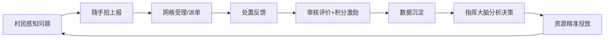
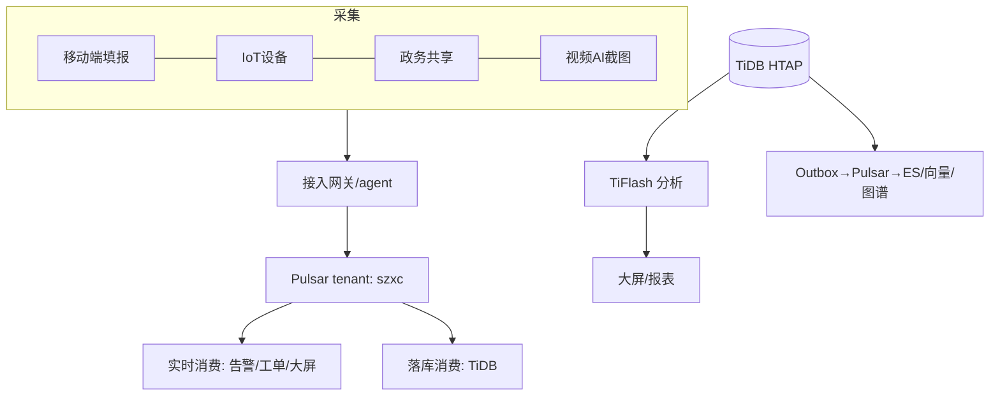
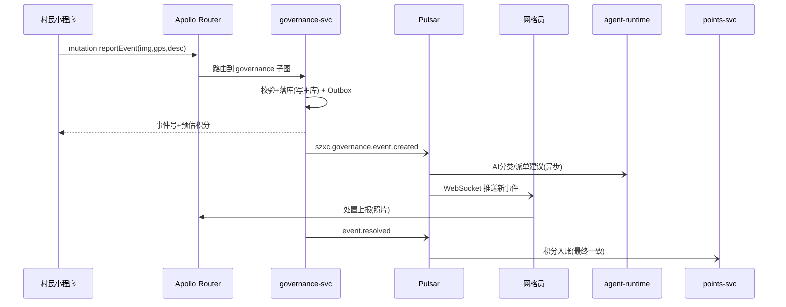

# 03 总体架构设计说明书（TOGAF 10）

> 覆盖 TOGAF ADM 关键制品：业务架构、数据架构、应用架构、技术架构（BDAT），并给出架构原则、视图与治理。

---

## 1. 架构愿景与原则

**愿景**：一套可从县域试点平滑扩展到百万用户的数字乡村操作系统。

**架构原则（决策仲裁依据）**

| # | 原则 | 含义 |
|---|---|---|
| P1 | 复用优先 | 集群已有中间件一律复用，不重复建设（指南 2.0 要求） |
| P2 | 无状态应用 | 应用零本地状态，任何 Pod 可杀可扩 |
| P3 | 读写分离、缓存先行 | 读路径四级缓存，写路径唯一入口 |
| P4 | 事件驱动最终一致 | 跨域协作用领域事件 + Outbox，不用分布式事务 |
| P5 | 契约先行（SDD） | GraphQL SDL/AsyncAPI 是唯一事实源，先契约后实现 |
| P6 | 敏感最小化 | 位置/健康等敏感数据独立存储、字段加密、单独同意 |
| P7 | 可观测性内建 | 服务上线即带指标/日志/追踪三信号 |
| P8 | 降级有序 | 依赖故障时核心链路可用（治理事件上报不可因 AI 挂掉而不可用） |

## 2. 业务架构（BA）

### 2.1 业务价值流



### 2.2 业务能力地图（CBM）

| 战略层 | 治理决策分析 ｜ 产业产销调度 ｜ 服务资源配置 |
|---|---|
| **战术层** | 网格事件闭环 ｜ 三务公开 ｜ 积分运营 ｜ 农事计划 ｜ IoT 联动 ｜ 预约核销 ｜ 知识问答 |
| **执行层** | 账号认证 ｜ 内容发布 ｜ 遥测采集 ｜ 支付对接 ｜ 消息通知 ｜ 报表大屏 |

## 3. 数据架构（DA）

### 3.1 数据域划分（详设见 05 号文档）

| 数据域 | 载体 | 说明 |
|---|---|---|
| 主数据（人/户/组织/地块/设备/商品） | TiDB `szxc_md` | 金源头，黄金记录，变更发出主数据事件 |
| 交易数据（事件/工单/积分/订单/预约） | TiDB `szxc_biz`（按域 schema） | 读写分离目标库 |
| 时序数据（遥测） | TiDB 宽表按天分区 + 热数据 Redis | 5K 点/s 级 |
| 文档/媒体 | MinIO + NFS | 全景图/照片/附件 |
| 知识数据 | Milvus（向量）+ NebulaGraph（关系）+ TiDB（语料元数据） | RAG 与图谱 |
| 分析数据 | TiDB `szxc_dws` 汇总层（TiFlash 引擎读） | 指标/大屏 |

### 3.2 数据流视图



### 3.3 数据治理要点

- 主数据管理（MDM）：六大主数据实体、黄金记录合并规则、唯一编码（组织编码沿用统计局区划码）。
- 数据质量六性：完整性/准确性/一致性/及时性/唯一性/有效性，规则引擎每周扫描出报告。
- 血缘：Pulsar 事件主题命名规范 `szxc.<域>.<实体>.<动作>`（AsyncAPI 登记）。
- 分类分级：按 GB/T 43697-2024，敏感字段清单见 11 号文档。

## 4. 应用架构（AA）

### 4.1 应用分层总图

```mermaid
flowchart TB
  subgraph L4[体验层]
    H5[村民H5] XCX[微信小程序] PC[管理Web] DS[指挥大屏] APP[村干App]
  end
  subgraph L3[接入与聚合层 - 指挥中枢]
    ROUTER[Apollo Router 联邦网关]
    RT[realtime-gateway WS/SSE]
    AGT[agent-runtime 智能体]
    MCPT[mcp-dv-tools MCP工具]
  end
  subgraph L2[领域服务层 - DDD限界上下文]
    IAM[iam-svc] PRT[portal-svc] GOV[governance-svc] PTS[points-svc]
    AGR[agri-svc] IOT[iot-svc] TRC[trace-svc] TRM[tourism-svc]
    SRV[service-svc] ELD[elder-svc] DAT[data-svc]
  end
  subgraph L1[数字底座]
    TIDB[(TiDB)] REDIS[(RedisCluster)] PUL[Pulsar] MIL[(Milvus)] NEB[(Nebula)] S3[(MinIO/NFS)] LLM[LiteLLM/Ollama]
  end
  L4 --> ROUTER & RT
  ROUTER --> L2
  AGT --> MCPT --> L2
  AGT --> MIL & LLM
  L2 --> L1
```

### 4.2 服务清单与职责（12 个领域服务 + 3 个平台组件）

| 服务 | 上下文 | 核心职责 | 团队建议 |
|---|---|---|---|
| iam-svc | 身份与组织 | 认证(手机号/微信)、组织树、RBAC+ABAC、多租户 | 平台组 |
| portal-svc | 门户与内容 | 三务公开、资讯公告、内容审核 | 业务组A |
| governance-svc | 乡村治理 | 网格、事件闭环、投票、AI 立项辅助 | 业务组A |
| points-svc | 积分 | 积分账户/流水/规则引擎/对账 | 业务组A |
| agri-svc | 智慧农业 | 地块、农事、农资、产销 | 业务组B |
| iot-svc | 物联 | 设备、遥测、告警、控制指令 | 业务组B |
| trace-svc | 溯源 | 批次、环节、哈希存证、核验 | 业务组B |
| tourism-svc | 文旅 | 景点/民宿、预约库存、一码通 | 业务组C |
| service-svc | 公共服务 | 办事指南/证明/补贴/缴费代办 | 业务组C |
| elder-svc | 一老一小 | 设备绑定、位置与告警（敏感隔离） | 业务组C |
| data-svc | 数据中台 | 指标计算、大屏聚合 API、数据资产目录 | 数据组 |
| agent-runtime | 数字乡村大脑 | LangGraph 编排、RAG、意图路由 | AI组 |
| mcp-dv-tools | MCP 工具层 | 业务查询/办理工具的 MCP Server | AI组 |
| apollo-router | 联邦网关 | 超图路由、APQ、限流 | 平台组 |
| realtime-gw | 实时推送 | WS/SSE 告警与消息推送 | 平台组 |

### 4.3 关键交互时序（事件上报闭环）



## 5. 技术架构（TA）

### 5.1 部署视图（K8s，详见 10 号文档）

| 层 | 部署形态 |
|---|---|
| 网关 | apollo-router ×2（跨节点反亲和），NodePort 30085 |
| 领域服务 | 每服务 2 副本起步 + HPA(2→8, CPU 60%)，跨节点分布 |
| agent-runtime | 2 副本，长任务走 Pulsar 异步 |
| 有状态 | 全部复用 infra（TiDB/Redis/Pulsar/Milvus/Nebula），不新增有状态 |
| 配置 | Nacos（应用配置）+ K8s ConfigMap/Secret（部署配置） |
| 观测 | OTel SDK → Prometheus/Promtail-Loki/Grafana（复用 monitoring） |

### 5.2 读写分离与缓存拓扑（详见 05）

```
读: Client → CDN(建议) → nginx(ingress micro_cache 5s~60s) → Router(APQ+响应缓存Redis) 
    → BFF/服务 L1 Caffeine(30s~5min) → L2 Redis(5~30min) → TiDB读池(从库标签) → TiFlash(分析)
写: Client → Router → 服务 → 写TiDB主池 → Outbox → Pulsar → 异步 fan-out(积分/向量/图谱/通知)
```

### 5.3 横切关注点

- **认证**：JWT（RS256 签名，15min AT + 30d RT），网关校验后向子图透传 X-User-* 头；服务间内网信任 + mTLS 可选（一期 SDK 层签名）。
- **限流**：Router 层按 token 桶（IP/用户/API 三维），Nginx 层连接数限流。
- **幂等**：所有 mutation 携带 Idempotency-Key，Redis SETNX 去重窗口 24h。
- **审计**：写操作审计事件 `szxc.audit.*` 入 Pulsar → TiDB 审计表，保留 3 年。
- **降级**：AI 不可用→静态 FAQ；支付不可用→线下核销；政务接口不可用→申报制。

## 6. 架构治理（TOGAF 治理落地）

- **架构评审委员会（ARB）**：重大技术决策走 ADR（Architecture Decision Records，存 `docs/adr/`）。
- **ADR-001**：选 Apollo Router 而非自研网关；**ADR-002**：TiDB 单集群多库而非每服务独立库（团队规模与运维成本权衡）；**ADR-003**：Pulsar 而非 Kafka；**ADR-004**：MCP 先行 A2A 预留；**ADR-005**：溯源用哈希存证非区块链。已在本套文档固化。
- **演进路线触发器**：用户 >50 万或 QPS >2 万 → 启用 CDN + 扩容节点（08 号文档）；租户 >3 县 → CockroachDB 承接跨县联邦查询评估。
