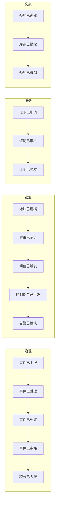
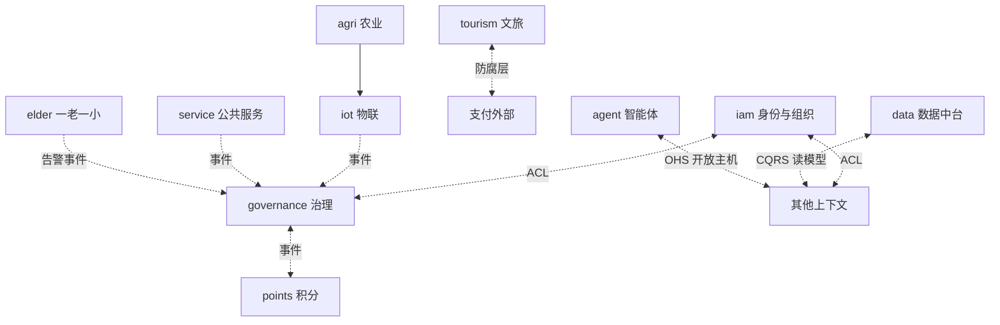

# 04 DDD 领域设计与微服务详细设计

> 方法：事件风暴（Event Storming）→ 限界上下文映射 → 聚合/实体/值对象/领域事件 → 六边形代码结构 → 测试策略（TDD/BDD 落点）。

---

## 1. 事件风暴产出（域事件时间线摘要）



（完整事件字典见 §6，全部事件登记于 AsyncAPI，命名 `szxc.<ctx>.<entity>.<verb-past>`）

## 2. 限界上下文映射图（Context Map）



关系语义：ACL=防腐层（外部系统/老旧接口）、OHS=开放主机（GraphQL/MCP）、事件=发布订阅解耦、CQRS=读侧投影。

## 3. 各上下文战术设计（聚合/实体/领域服务/领域事件）

### 3.1 iam-svc（身份与组织）

- **聚合根**：`Organization`（区划树节点：code 统计局区划码、type 县/乡/村/组、status）
- **聚合根**：`Party`（人员主体：realName、phone（SM4）、idCard（SM4+脱敏）、householdId、orgCode）
- **聚合根**：`Account`（登录账号：credential、roles[]、status；与 Party 1:1）
- 值对象：`Phone`、`IdCard`（自校验）、`Address`、`PermissionScope`（ABAC 数据范围）
- 领域服务：`AuthService`（登录/换发 token）、`PermissionService`（RBAC+ABAC 合成判定）
- 领域事件：`iam.party.created/updated`、`iam.account.locked`、`iam.org.changed`
- 不变量：手机号全局唯一；删除=逻辑删除且保留审计；角色继承不超过 3 层。

### 3.2 governance-svc（乡村治理）

- **聚合根**：`GovernanceEvent`（事件单：sn、type、source(随手拍/AI/网格巡查)、location(GIS点)、state[草稿/待受理/已受理/处置中/待审核/已办结/已退回]、photos[]、slaDeadline）
  - 行为：`submit()`、`accept(assignee)`、`dispatch(gridWorker)`、`resolve(evidence)`、`approve()`、`reject(reason)`、`escalate()`（SLA 超时自动触发，Pulsar 延迟消息实现）
- **聚合根**：`Grid`（网格：边界 GeoJSON、gridWorkerId、villageCode）
- **聚合根**：`Vote`（议题投票：topic、options[]、eligibleScope、startAt/endAt、anonymity=true）
  - 行为：`cast(voterId, option)`——一人一票幂等（唯一索引 voter+vote）
- **聚合根**：`Publication`（三务公开：column(村务/财务/党务)、content、attachments[]、publishAt、auditState）
- 领域服务：`EventAIPreClassifier`（调用 agent-runtime，超时降级人工）
- 领域事件：`governance.event.created/accepted/dispatched/resolved/approved/rejected/escalated`、`governance.vote.cast/closed`、`governance.publication.published`

### 3.3 points-svc（积分）

- **聚合根**：`PointsAccount`（partyId、balance、frozen、version 乐观锁）
  - 行为：`earn(rule, refId)`、`deduct(reason, refId)`、`freeze(amount, refId)`、`settle()`
- **实体**：`PointsRule`（code、triggerEvent、points、dailyCap、status）
- **实体**：`RedeemOrder`（兑换单：sku、points、state[待发货/已发货/已完成/已取消]）
- 不变量：余额不可为负；每笔变动有唯一 refId 幂等；流水不可篡改（只插入）。
- 领域事件：`points.earned/deducted/redeemed`；订阅 `governance.event.approved` 等触发 earning（消费端幂等）。

### 3.4 agri-svc（智慧农业）

- **聚合根**：`Plot`（地块：parcelCode、boundary(GeoJSON)、crop、farmerPartyId、soilInfo）
- **聚合根**：`FarmPlan`（农事计划：plotId、cropCycle、tasks[(播种/施肥/灌溉/采收, planDate, done)]）
- **聚合根**：`AgriInput`（农资：sku、stock、batchNo、safetyInterval）
- 领域服务：`MarketAdvisor`（产销推荐，订阅外部价格数据源）
- 领域事件：`agri.plot.created`、`agri.task.completed`、`agri.market.updated`

### 3.5 iot-svc（物联）

- **聚合根**：`Device`（deviceId、type(墒情/气象/虫情/手环/摄像头)、plotId/villageCode、secret、status）
- **聚合根**：`ControlCommand`（指令：deviceId、action、state[待复核/已下发/已确认]、双签人）
- 领域服务：`TelemetryIngest`（Pulsar 消费→批量写 TiDB 分区表 + 热窗口 Redis）、`RuleEngine`（阈值规则→发布 `iot.alarm.raised`）、`CommandGuard`（控制类指令双人复核，防误操作）
- 领域事件：`iot.device.registered/online/offline`、`iot.telemetry.batched`、`iot.alarm.raised/cleared`、`iot.command.issued/confirmed`

### 3.6 service-svc（公共服务）/ elder-svc（一老一小）/ tourism-svc（文旅）/ trace-svc（溯源）/ portal-svc（门户）

| 上下文 | 聚合根 | 关键不变量/事件 |
|---|---|---|
| service | `ServiceItem`(事项)、`CertificateApplication`(证明申请)、`SubsidyQuery`(投影) | 签发带 SM2 签名+时间戳；`service.cert.issued` |
| elder | `CareDevice`(绑定)、`CareAlarm`(告警)、`Guardian`(监护人) | 位置轨迹单独库 `szxc_sensitive`，SM4，访问需单独同意记录；`elder.alarm.raised` |
| tourism | `ScenicAsset`、`BookingOrder`(预约)、`PassCode`(一码通) | 分时段库存乐观锁扣减；超时未支付释放；`tourism.booking.created/verified` |
| trace | `TraceBatch`(批次)、`TraceRecord`(环节)、`AnchorRecord`(哈希锚定) | 每环节 prevHash 链式哈希+SM3；`trace.batch.anchored` |
| portal | `Content`、`Category`、`Comment` | 发布需审核工作流；`portal.content.published` |

### 3.7 data-svc（数据中台，CQRS 读侧）

- 模式：订阅各域事件 → 物化读模型（指标宽表）→ GraphQL 直供大屏。
- 指标示例：事件办结率、平均处置时长、积分活跃度、IoT 在线率、预约核销率、AI 问答满意度。
- 调度：分钟级实时（事件驱动累计）+ 日级全量校准（TiFlash 批算）双轨，防止漂移。

## 4. 六边形代码结构（Java 服务统一模板）

```
svc-<name>/
 ├─ api/            # GraphQL SDL(DGS schema)、对外 DTO、mapper
 ├─ application/    # 用例服务(CQRS command/query)、事务边界、端口接口
 ├─ domain/         # 聚合、实体、值对象、领域事件、领域服务、仓储接口
 ├─ infrastructure/ # 仓储实现(TiDB/SpringData)、Pulsar 适配器、Redis、外部客户端(ACL)
 └─ adapter/        # GraphQL Resolver(DGS)、事件监听器、定时任务
```

依赖规则：adapter→application→domain；infrastructure 实现 domain 端口（依赖倒置）。每个聚合一张表 + Outbox 表同事务。

## 5. 一致性策略

| 场景 | 策略 |
|---|---|
| 单聚合内 | ACID（本地事务） |
| 跨上下文 | Outbox + Pulsar，至少一次投递 + 消费端幂等（refId 唯一键） |
| 扣减类（积分/库存） | 乐观锁 version + 重试 3 次 + 补偿事件 |
| 读侧 | CQRS 投影，允许秒级延迟；大屏标注数据时点 |

## 6. 领域事件字典（节选，完整登记于 AsyncAPI）

| Topic | 生产者 | 消费者 | 载荷要点 |
|---|---|---|---|
| szxc.governance.event.created | governance | agent(AI分类)、realtime(推送)、data | eventId,type,location,source |
| szxc.governance.event.approved | governance | **points**(积分入账)、data | eventId,workerId,ruleCode |
| szxc.iot.alarm.raised | iot | realtime、governance(立案)、elder | alarmId,deviceId,level,lat/lng |
| szxc.points.redeemed | points | data、(外部履约) | orderId,partyId,points |
| szxc.tourism.booking.created | tourism | data、(支付回调) | orderId,slotId,qty |
| szxc.trace.batch.anchored | trace | data | batchId,rootHash,ts |

## 7. 测试落点（TDD/BDD 映射，详见 09 号文档）

- **单元（TDD）**：聚合行为与不变量（如 `PointsAccount.deduct` 余额不可负；`GovernanceEvent.escalate` 仅超时可触发）——纯域对象，毫秒级。
- **契约（SDD）**：GraphQL SDL + Pact 消费者驱动；Pulsar 事件 JSON Schema 校验。
- **BDD（验收）**：Gherkin 场景例——
  ```gherkin
  场景: 村民上报事件并获得积分
    假如 村民"张三"已登录
    当 他通过随手拍上报"垃圾堆放"事件
    那么 系统返回事件号且状态为"待受理"
    而且 网格员处置并审核通过后
    那么 张三积分账户增加 20 分，且流水可查
  ```
